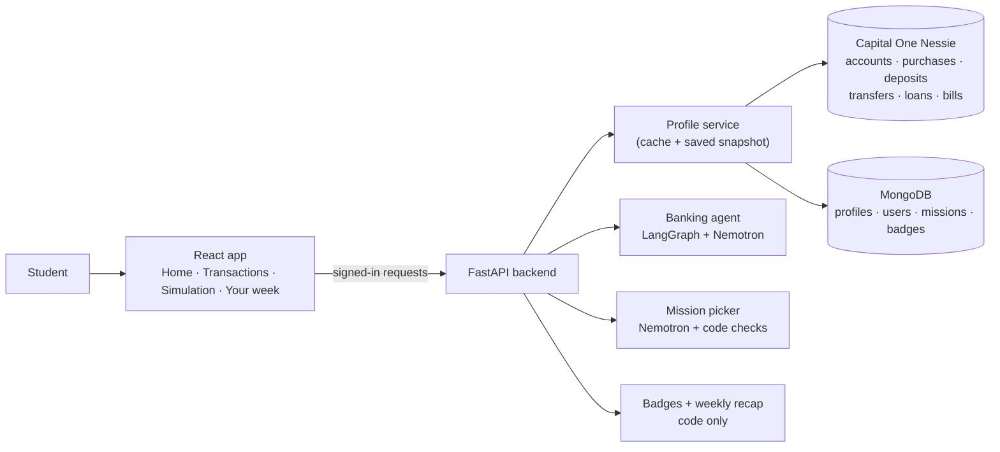
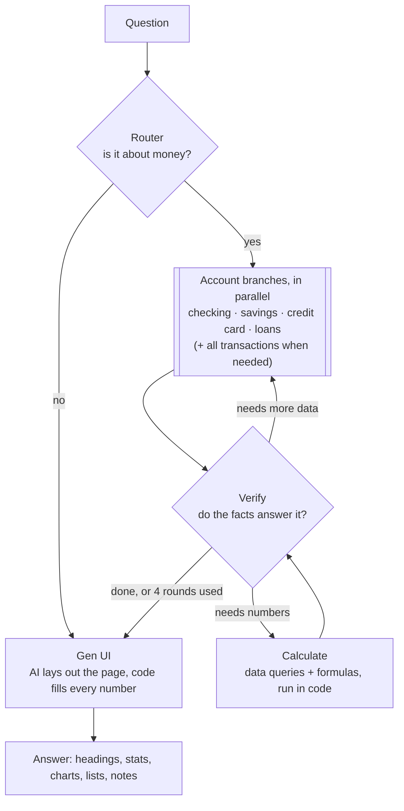
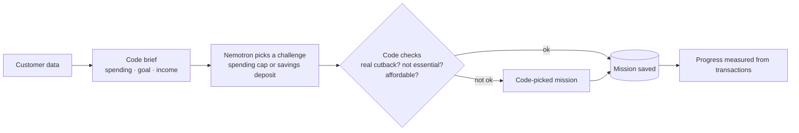

# Waypoint
An app for reaching your financial goals

*Your financial life. One place. A clearer direction.*

An AI-powered financial intelligence backend for college students, built on the PNC
Financial Wellness toolkit, Capital One's Nessie API and NVIDIA Nemotron.

Pipeline: **PNC-convention synthetic data → mapping → Nessie seeding → Nessie retrieval →
unified profile → wellness engine → LangGraph + Nemotron simulation.**

## What's in the app

- **Goal bar:** progress toward the student's goal, checkpoints (25/50/75/100%), a forgiving savings streak, and how many days the last deposit saved.
- **Missions:** a weekly mission and a daily challenge, picked by AI from the student's own spending and checked against their transactions.
- **Badges:** earned only from verified wins (goal milestones, deposit streaks, completed missions); shown in the sidebar and kept once earned.
- **Your week:** a recap of the last 7 days or the last calendar week: spending vs a usual week, top merchant, money saved, missions and badges.
- **Simulation:** ask any money question ("Can I afford the car by Christmas?") and get a written answer with stats and charts; any answer can become this week's mission.
- **Accounts and transactions:** balances, history and upcoming bills from Capital One Nessie.
- **Money at a glance:** a radar on Home comparing this month with last month on savings, checking, credit owed and number of transactions.

**The one rule everywhere:** AI chooses and explains, code computes. Every number shown comes from the student's records or from maths run in code.



## Status

| Phase | Scope | Status |
|---|---|---|
| 1 | Repository and API inspection | Done |
| 2 | Student profile generation, mapping, validation | Done |
| 3 | Nessie seeding and verification | Done |
| 4 | Nessie retrieval, unified profile, API with demo login | Done |
| 5 | Financial wellness engine | Next |
| 6–7 | Banking agent, Simulation, integration | Done |
| 8 | Missions, badges, weekly recap | Done |

## Setup

```bash
pip install -r requirements.txt
cp .env.example .env   # then fill in NESSIE_API_KEY and MONGODB_URI
```

`.env` is gitignored. Secrets are read from the environment only (`backend/config.py`).
MongoDB Atlas: URL-encode special characters in the password (`,` → `%2C`), and allow your IP
under Atlas → Network Access.

### Banking agent

`POST /api/me/agent` with `{"question": "..."}` (signed in). Set `NVIDIA_API_KEY`, `PLANNER_MODEL` and
`WORKER_MODEL` in `.env`; without them the endpoint answers with a short fallback instead of failing.



- **Any money question.** Only non-financial questions are refused. General questions ("how does APR work?") are answered as general information.
- **Real maths.** Verify can ask code to query transactions (by merchant, category, dates; sum, count, average, top 5) and to run formulas (including interest and loan payoff). Results become facts the answer can cite.
- **Credible by design.** The AI writes `{fact}` placeholders, never numbers; code fills them in, rejects invented figures, and drops any bad block. Bank access is read-only.
- **Bounded.** At most 4 rounds; a failure falls back to a code-written answer.
- **Logs.** `waypoint.agent` logs each step without question text, IDs or amounts. Keep `LANGSMITH_TRACING` off (it would send account data out).

### Missions

`GET /api/me/mission`, `POST /api/me/mission?period=week|day` (optional `{"hint": "..."}`, e.g. a Simulation question).



Badges (`GET /api/me/badges`) and the weekly recap (`GET /api/me/recap?mode=last7|calendar`) are computed in code
only. Status and limits: `docs/BANKING_AGENT_CHECKLIST.md` and `docs/BANKING_AGENT_CALCULATE_PLAN.md`.

## Demo CLI

Add real activity to Nessie and watch the goal and missions update (API running on port 8000):

```bash
.venv/bin/python scripts/demo.py status             # goal progress, next checkpoint, missions
.venv/bin/python scripts/demo.py save 25            # $25 goal deposit: the goal bar moves
.venv/bin/python scripts/demo.py spend dining 12    # $12 purchase at a merchant you already use
```

Then reload the dashboard (or press ↻ on Missions). Options: `--email` for another demo user, `--api` for another
URL. The goal's saved amount is its starting amount plus the goal deposits in the transactions, so new deposits
count. Writes are permanent in the Nessie sandbox (`scripts/seed_nessie.py <profile> --reset --yes` clears them), and
Nessie never changes account balances for new transactions.

## Phase 2 pipeline

```bash
python scripts/generate_pnc_profiles.py     # data/profiles/     student profiles (PNC conventions)
python scripts/generate_missing_fields.py   # data/generated/    Nessie-only fields
python scripts/map_financial_profile.py     # data/seed_plans/   Nessie requests; data/normalized/ unified profiles
python scripts/validate_profile.py          # data/validation/   consistency reports
python scripts/validate_profile.py --save-mongo   # also upsert into MONGODB_URI
python -m pytest
```

Generation is deterministic, so re-running produces identical files.

## Phase 3: seed and verify Nessie

```bash
python scripts/seed_nessie.py               # all profiles; safe to re-run
python scripts/verify_nessie_data.py        # read back from Nessie and reconcile
python scripts/seed_nessie.py stu-001 --reset --yes   # delete stu-001's Nessie accounts/records, reseed
```

- Seeding is idempotent. Each plan step has a stable key. Nessie ids are stored in MongoDB
  (`nessie_id_map`) the moment they are created, and exported to `data/local/nessie/` (gitignored).
- If MongoDB has no id for a step (fresh database, crash, another machine), the seeder finds
  the existing Nessie record by its `[wp:...]` marker and reuses it instead of duplicating it.
- Verification checks every record and field, account balances, each account's net activity
  against the ledger, monthly income, and stray marker-tagged records. Reports go to
  `data/local/verification/` (gitignored) and the `seed_runs` collection.
- Seeding is a setup step only. Simulations never write to Nessie.

## Phase 4: run the API

```bash
python scripts/validate_profile.py --save-mongo   # profiles in MongoDB
python scripts/seed_nessie.py                     # Nessie ids in MongoDB
uvicorn backend.api.main:app --reload --port 8000
```

Log in at `http://localhost:8000/docs` with any demo login below (password **waypoint-demo**).
Each login sees only its own student. Banking data is read live from Nessie and
merged with PNC-only data from MongoDB. See [docs/API.md](docs/API.md).

## Run the frontend

The React app lives in `client/`. Start the API (above) first, then in a second terminal:

```bash
cd client
npm install      # first time, or after package.json changes
npm run dev      # http://localhost:5173
```

Sign in with any demo login (password **waypoint-demo**): `poyo@`, `lucas@`, `leah@` or `priya@waypoint.demo`.

- In dev, Vite proxies `/auth` and `/api` to `http://localhost:8000` (`client/vite.config.ts`), so no
  CORS setup is needed. For a backend elsewhere: `WAYPOINT_API_URL=http://host:port npm run dev`.
- "Can't reach the Waypoint server" on sign-in means the API isn't running on port 8000.
- The session token is kept in `localStorage` (`waypoint.session`). Use **Sign out** in the sidebar's
  account menu, or delete that key, to log out.
- Production: `npm run build` outputs `client/dist`. The proxy only exists in dev, so set
  `VITE_API_BASE_URL` to the API's URL at build time and add the site's origin to the API's `CORS_ORIGINS`.

## Demo profiles

| ID | Demo login | Student | Highlights |
|---|---|---|---|
| `stu-001` | `lucas@waypoint.demo` | Lucas Patel, UT Dallas junior, CS, library job + family support | Card paid in full, deferred unsubsidized loan, emergency-fund goal |
| `stu-002` | `poyo@waypoint.demo` | Poyo de Avon, UNT sophomore, lives at home, retail job | No card, saving for a first car |
| `stu-003` | `leah@waypoint.demo` | Leah Walker, Texas A&M senior, co-op internship | Auto loan, card carried at ~28% utilization, relocation goal |
| `stu-004` | `priya@waypoint.demo` | Priya Ramirez, UT Austin freshman, dining job + aid refund | Subsidized loan, card carried, tuition-gap goal |

## Layout

```
backend/
  generation/   student generator (PNC conventions), personas, merchant catalog
  mapping/      Nessie-only field generation, PNC→Nessie seed plan, unified profile
  validation/   financial consistency checks
  schemas/      Pydantic models (student profile, Nessie bodies, seed plan, unified profile)
  database/     MongoDB persistence (students, goals, seed_plans, nessie_id_map, seed_runs)
  integrations/nessie/  Nessie HTTP client, response schemas, retrieval gateway
  seeding/      idempotent Nessie seeder, reset, read-back verifier
  services/     ProfileService: cached Nessie retrieval with snapshot and pre-seed fallbacks
  auth/         demo users (one per student), password hashing, signed session tokens
  api/          FastAPI app (uvicorn backend.api.main:app)
  pipeline.py   generate → fill → map → normalize → validate
scripts/        runnable pipeline steps
data/           generated sample outputs (committed); data/local/ holds run reports and id maps (gitignored)
docs/           DATA_MAPPING.md
third_party/pnc_wellness/   vendored PNC toolkit (Apache-2.0, unmodified)
tests/
```

See [docs/DATA_MAPPING.md](docs/DATA_MAPPING.md) for the field mapping and the verified
Nessie API behavior that shaped it.


# 1. Install dependencies in a virtual environment (one time)
python3 -m venv .venv
source .venv/bin/activate
pip install -r requirements.txt

# 2. Set up the data (one time; it's safe to run again)
python scripts/validate_profile.py --save-mongo   # saves the student profiles to MongoDB
python scripts/seed_nessie.py                     # creates their accounts in Nessie

# 3. Start the API
python -m uvicorn backend.api.main:app --reload --port 8000
