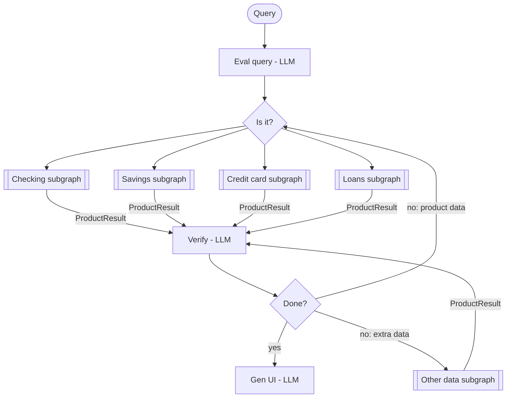

# Banking Agent: LangGraph + Nemotron Build Guide (Subgraph Version)

A step-by-step plan for building the **refactored-with-subgraphs** design: a main graph that routes a query to product subgraphs (Checking, Savings, Credit Card, Loans, Other Data), verifies the combined results, loops if more data is needed, and generates the UI.

> LangGraph and LangChain change often. The code below shows the shape of each step; if an import or method name fails, check the current docs at <https://langchain-ai.github.io/langgraph/>.

---

## Target architecture



Each product subgraph internally runs: **fetch from APIs → product-specific steps → Eval data (LLM) → return `ProductResult`**.

**Build order:** contracts first, then one subgraph end to end, then the rest, then the main graph. Don't wire the main graph until at least one subgraph works on its own.

---

## Step 1: Set up the project

```bash
mkdir banking-agent && cd banking-agent
python -m venv .venv && source .venv/bin/activate
pip install langgraph langchain langchain-nvidia-ai-endpoints pydantic python-dotenv jsonschema
echo "NVIDIA_API_KEY=nvapi-your-key-here" > .env
```

Suggested layout:

```
banking-agent/
├── .env
├── main.py                  # entry point: run a query
├── agent/
│   ├── __init__.py
│   ├── llm.py               # Nemotron model setup (planner + worker)
│   ├── schemas.py           # ProductResult, RouteDecision, VerifyDecision
│   ├── state.py             # main graph state
│   ├── apis/                # API clients (mocked first)
│   │   ├── checking.py
│   │   ├── savings.py
│   │   ├── credit_card.py
│   │   ├── loans.py
│   │   └── other.py         # transactions, other API, bio data
│   ├── subgraphs/
│   │   ├── checking.py
│   │   ├── savings.py
│   │   ├── credit_card.py
│   │   ├── loans.py
│   │   └── other_data.py
│   ├── nodes/
│   │   ├── eval_query.py    # router
│   │   ├── verify.py
│   │   └── gen_ui.py
│   ├── ui/
│   │   ├── components.py    # BarChart, TextBlock, UISpec (mirror the chart spec)
│   │   ├── plan.py          # UIPlan: the LLM's small presentation plan
│   │   └── validate.py      # schema + grounding checks
│   └── graph.py             # wires the main graph
├── schemas/
│   └── bar_chart.schema.json  # BarChartSpec from the frontend
└── tests/
    ├── test_checking_subgraph.py
    └── test_main_graph.py
```

**Done when:** the venv is active, packages install, and the API key loads.

---

## Step 1b: Set up Nemotron (`agent/llm.py`)

The agent runs on NVIDIA Nemotron through LangChain's `ChatNVIDIA`. Every node imports its model from this one file, so switching models later only touches this file.

### Get an API key

1. Log in at **build.nvidia.com**.
2. Open a Nemotron model (e.g. Nemotron 3 Super) and click **View Code**.
3. Click **Generate API Key**. It starts with `nvapi-`; put it in `.env` as `NVIDIA_API_KEY`.
4. While you're there, copy the exact **model ID** from the code sample. Model IDs change between releases, so use what the page shows rather than the examples below.

### Use two model sizes

Give reasoning-heavy decisions to the larger model and repetitive per-product work to the smaller, faster one.

| Model role | Used by | Suggested Nemotron model |
|---|---|---|
| `planner_llm` | Eval Query (router), Verify, Gen UI | Nemotron Super |
| `worker_llm` | Each subgraph's Eval Data, Other Data's "Need?" | Nemotron Nano |

```python
# agent/llm.py
import os
from dotenv import load_dotenv
from langchain_nvidia_ai_endpoints import ChatNVIDIA

load_dotenv()  # reads NVIDIA_API_KEY

# Paste the exact IDs from "View Code" on build.nvidia.com
PLANNER_MODEL = os.getenv("PLANNER_MODEL", "nvidia/nemotron-3-super-120b-a12b")
WORKER_MODEL = os.getenv("WORKER_MODEL", "<nemotron-nano-model-id>")

# Optional: point at a self-hosted NIM on a Brev GPU instance instead of the hosted API
NIM_BASE_URL = os.getenv("NIM_BASE_URL")  # e.g. http://<brev-instance>:8000/v1

def _make(model: str) -> ChatNVIDIA:
    kwargs = {"model": model, "temperature": 0}
    if NIM_BASE_URL:
        kwargs["base_url"] = NIM_BASE_URL
    return ChatNVIDIA(**kwargs)

planner_llm = _make(PLANNER_MODEL)
worker_llm = _make(WORKER_MODEL)
```

### Make structured output reliable

Every decision node uses `with_structured_output(...)`. Use this helper everywhere so you can fix structured-output problems in one place:

```python
# agent/llm.py (continued)
from pydantic import BaseModel, ValidationError

def structured(model: ChatNVIDIA, schema: type[BaseModel], prompt: str, retries: int = 2):
    """Call the model and return a validated Pydantic object, retrying on bad output."""
    runner = model.with_structured_output(schema)
    # If tool-based structured output is flaky on your model, try:
    # runner = model.with_structured_output(schema, method="json_mode")
    last_error = None
    for _ in range(retries + 1):
        try:
            result = runner.invoke(prompt)
            if result is not None:
                return result
        except (ValidationError, ValueError) as e:
            last_error = e
            prompt += f"\n\nYour last reply was invalid ({e}). Reply with JSON matching the schema only."
    raise RuntimeError(f"Structured output failed for {schema.__name__}: {last_error}")
```

### Reasoning mode

Some Nemotron models can reason before answering, toggled through the system prompt (NVIDIA's sample uses a `/think` system message). Turn it on where judgment matters (router, Verify) and leave it off for simple eval nodes to save time. Check the model card for the exact flag your model uses.

### Rate limits

The free hosted tier has rate limits, and your subgraphs run in parallel. If you hit limits:
- add retries with backoff, or
- run the model as a NIM on a Brev GPU instance and set `NIM_BASE_URL` in `.env`.

### Quick smoke test

```python
from agent.llm import planner_llm, worker_llm
print(planner_llm.invoke("Reply with the word ready.").content)
print(worker_llm.invoke("Reply with the word ready.").content)
```

**Done when:** both models reply, and `structured(worker_llm, ProductResult, "...")` returns a valid object (run this after Step 2).

---

## Step 2: Define the shared contracts (`agent/schemas.py`)

These are the most important decisions in the project. Every subgraph returns the same `ProductResult`, and every LLM decision node returns a typed object instead of free text.

```python
from typing import Literal
from pydantic import BaseModel, Field

Product = Literal["checking", "savings", "credit_card", "loans"]

class ProductResult(BaseModel):
    """What every subgraph hands back to Verify."""
    product: str                      # "checking", "loans", "other_data", ...
    summary: str                      # LLM's plain-language read of the data
    data: dict                        # raw/cleaned API data Verify can check against
    confidence: float = Field(ge=0, le=1)
    errors: list[str] = []            # API failures, missing fields, etc.

class RouteDecision(BaseModel):
    """Output of Eval Query / 'Is it?'."""
    products: list[Product]           # one or more branches to run
    reasoning: str

class VerifyDecision(BaseModel):
    """Output of Verify / 'Done?'."""
    done: bool
    need_products: list[Product] = [] # re-run these product subgraphs
    need_other_data: bool = False     # run the Other Data subgraph
    missing: str = ""                 # what's still missing, in words
```

**Done when:** you can construct each model by hand in a Python shell.

---

## Step 3: Define the main graph state (`agent/state.py`)

`results` uses a reducer (`operator.add`) so that subgraphs running in parallel append their results instead of overwriting each other.

```python
import operator
from typing import Annotated, TypedDict
from agent.schemas import ProductResult, RouteDecision, VerifyDecision

class AgentState(TypedDict, total=False):
    query: str
    route: RouteDecision
    results: Annotated[list[ProductResult], operator.add]
    verify: VerifyDecision
    iterations: int                   # loop counter for Done? -> No
    final_ui: dict
```

Keep this state small. Product-specific fields belong in each subgraph's private state (Step 5), not here.

---

## Step 4: Mock the APIs (`agent/apis/`)

Start with fake data so you can build and test the graph without real credentials. Give every API client the same simple interface.

```python
# agent/apis/checking.py
def get_checking_account(user_id: str) -> dict:
    return {
        "balance": 2450.12,
        "pending": [{"merchant": "Coffee Co", "amount": -4.75}],
        "last_deposit": {"date": "2026-11-01", "amount": 1800.00},
    }
```

Do the same for savings, credit card, loans, and the three "other" sources (transactions, other API, bio data). Later you replace the bodies with real API calls; nothing else in the graph needs to change.

**Done when:** each mock returns realistic-looking data, including at least one mock that returns an error so you can test failure handling.

---

## Step 5: Build ONE product subgraph end to end (`agent/subgraphs/checking.py`)

This is the template every other subgraph copies. It has its own private state, which can hold as many product-specific fields as you need.

```python
from typing import TypedDict
from langgraph.graph import StateGraph, START, END
from agent.apis.checking import get_checking_account
from agent.llm import worker_llm, structured
from agent.schemas import ProductResult

class CheckingState(TypedDict, total=False):
    query: str
    user_id: str
    raw: dict                 # private: raw API response
    errors: list[str]         # private
    result: ProductResult     # the only thing the parent reads

def fetch(state: CheckingState):
    try:
        return {"raw": get_checking_account(state["user_id"]), "errors": []}
    except Exception as e:
        return {"raw": {}, "errors": [f"checking api: {e}"]}

def product_steps(state: CheckingState):
    # Checking-specific work in plain code: totals, filtering, formatting.
    # Do math here, not in the LLM.
    raw = state["raw"]
    pending_total = sum(p["amount"] for p in raw.get("pending", []))
    return {"raw": {**raw, "pending_total": pending_total}}

def eval_data(state: CheckingState):
    result = structured(
        worker_llm, ProductResult,
        "You evaluate checking account data for a banking assistant.\n"
        f"User question: {state['query']}\n"
        f"Data: {state['raw']}\n"
        f"Errors: {state.get('errors', [])}\n"
        "Return product='checking', a short summary that answers the question "
        "using only this data, the relevant data fields, and a confidence score."
    )
    return {"result": result}

builder = StateGraph(CheckingState)
builder.add_node("fetch", fetch)
builder.add_node("product_steps", product_steps)
builder.add_node("eval_data", eval_data)
builder.add_edge(START, "fetch")
builder.add_edge("fetch", "product_steps")
builder.add_edge("product_steps", "eval_data")
builder.add_edge("eval_data", END)

checking_graph = builder.compile()
```

Subgraph eval nodes use `worker_llm` (Nemotron Nano) through the `structured()` helper from Step 1b.

---

## Step 6: Test that subgraph on its own

This is the main payoff of subgraphs: you can debug one branch without the rest of the agent.

```python
# tests/test_checking_subgraph.py
from agent.subgraphs.checking import checking_graph

out = checking_graph.invoke({"query": "What's my checking balance?", "user_id": "u1"})
print(out["result"])
assert out["result"].product == "checking"
```

Also test the failure path: make the mock raise an error and confirm the subgraph still returns a `ProductResult` with `errors` filled in and a low confidence.

**Done when:** the Checking subgraph returns a sensible `ProductResult` for both a normal query and a failing API.

---

## Step 7: Build the remaining subgraphs

Copy the Checking template for **Savings**, **Credit Card** and **Loans**. Change the state fields, API calls, `product_steps` logic and eval prompt for each product. Branches can differ freely inside; the only rule is that each one ends with a `ProductResult`.

The **Other Data** subgraph has one extra layer: its own "Need?" decision.

```
start → need? (LLM) → [transaction API | other API | bio data] → eval data (LLM) → ProductResult
```

Implement "Need?" as a `worker_llm` node returning a small structured object (e.g. `sources: list[Literal["transactions", "other_api", "bio"]]`), followed by a conditional edge that runs only the chosen fetch nodes.

**Done when:** each subgraph has its own test that passes, like Step 6.

---

## Step 8: Wrap each subgraph as a node in the main graph

Because each subgraph has its own state schema, wrap it in a small function that maps parent state in and the `ProductResult` back out. This boundary keeps private subgraph fields out of the main state.

```python
# agent/graph.py (part 1)
from agent.subgraphs.checking import checking_graph
from agent.subgraphs.savings import savings_graph
from agent.subgraphs.credit_card import credit_card_graph
from agent.subgraphs.loans import loans_graph
from agent.subgraphs.other_data import other_data_graph

USER_ID = "u1"  # replace with real auth/session handling

def make_subgraph_node(subgraph):
    def node(state):
        out = subgraph.invoke({"query": state["query"], "user_id": USER_ID})
        return {"results": [out["result"]]}   # appended via operator.add
    return node
```

---

## Step 9: Build Eval Query, the "Is it?" router (`agent/nodes/eval_query.py`)

```python
from agent.llm import planner_llm, structured
from agent.schemas import RouteDecision

def eval_query(state):
    feedback = ""
    if state.get("verify"):
        feedback = f"\nPrevious attempt was missing: {state['verify'].missing}"
    route = structured(
        planner_llm, RouteDecision,
        "Classify this banking question into the products needed to answer it: "
        "checking, savings, credit_card, loans. Pick every product that applies."
        f"\nQuestion: {state['query']}{feedback}"
    )
    return {"route": route}

def route_to_products(state) -> list[str]:
    # Returning several node names runs those subgraphs in parallel.
    return state["route"].products or ["checking"]
```

---

## Step 10: Build Verify and the "Done?" decision (`agent/nodes/verify.py`)

```python
from agent.llm import planner_llm, structured
from agent.schemas import VerifyDecision

MAX_ITERATIONS = 3

def verify(state):
    summaries = "\n".join(
        f"- {r.product} (confidence {r.confidence}): {r.summary} errors={r.errors}"
        for r in state.get("results", [])
    )
    decision = structured(
        planner_llm, VerifyDecision,
        "You check whether a banking assistant has enough verified data to answer.\n"
        f"Question: {state['query']}\nResults:\n{summaries}\n"
        "Set done=true only if the results fully answer the question. Otherwise "
        "say which products to re-check, whether extra data (transactions, bio) "
        "is needed, and what is missing."
    )
    return {"verify": decision, "iterations": state.get("iterations", 0) + 1}

def after_verify(state) -> str:
    v = state["verify"]
    if v.done or state["iterations"] >= MAX_ITERATIONS:
        return "gen_ui"            # hard stop: never loop forever
    if v.need_other_data:
        return "other_data"
    return "eval_query"            # "no: product data" -> back to the router
```

The iteration cap is required. Without it, a confused Verify can loop indefinitely.

---

## Step 11: Build Gen UI (`agent/nodes/gen_ui.py`)

Gen UI returns a list of **components**. Each component has a `type` and `props`, and your frontend renders each one by type:

```js
{ type: 'bar_chart', props: { title: ..., categories: [...], series: [...] } }
```

The `bar_chart` props follow `BarChartSpec` (`schemas/bar_chart.schema.json`). Save the spec file there so you can validate against it.

> **Format note:** the spec requires `categories` + `series` and rejects unknown fields. An older example passed `data: [{ label, value }]` instead, which the spec does not allow. This guide uses the spec's format. If your component actually takes `data`, use the `to_label_value()` converter in Step 11e.

### The core rule: code supplies the numbers, the LLM supplies the presentation

| Who | Decides |
|---|---|
| **Code** (from verified API data) | `categories`, `series[].values`, `valueFormat` |
| **LLM** (Nemotron Super) | which chart(s) to show, `title`, `subtitle`, `orientation`, `layout`, `sort`, `highlight`, `referenceLines`, `valueLabels`, the text answer |

A wrong number on a banking chart is the fastest way to lose a user's (or judge's) trust, and LLMs can round, drop or invent values. The LLM never types a number into a chart. It picks from datasets that code already built.

---

### Step 11a: Component models (`agent/ui/components.py`)

Pydantic mirrors of the spec, plus a simple text block.

```python
from typing import Literal, Union
from pydantic import BaseModel, Field

ColorName = Literal["purple", "teal", "orange", "blue", "neutral"]

class Series(BaseModel):
    name: str
    values: list[float | None]          # one per category; None = no data
    color: ColorName | None = None      # pin colours so entities match across charts

class ValueFormat(BaseModel):
    style: Literal["number", "currency", "percent"] = "number"
    currency: str | None = None         # ISO 4217, default USD on the frontend
    decimals: int | None = Field(default=None, ge=0, le=6)
    compact: bool | Literal["auto"] | None = None
    prefix: str | None = None
    suffix: str | None = None

class ReferenceLine(BaseModel):
    value: float
    label: str | None = None

class BarChartProps(BaseModel):
    title: str | None = None
    subtitle: str | None = None
    categories: list[str]
    series: list[Series] = Field(min_length=1, max_length=5)
    orientation: Literal["vertical", "horizontal"] = "vertical"
    layout: Literal["grouped", "stacked", "percent"] = "grouped"
    valueFormat: ValueFormat | None = None
    valueLabels: Literal["auto", "none", "all", "max", "min-max", "last", "totals"] = "auto"
    highlight: list[str] = []
    referenceLines: list[ReferenceLine] = []
    sort: Literal["none", "asc", "desc"] = "none"
    height: int | None = Field(default=None, ge=160, le=800)
    emptyMessage: str | None = None

class BarChart(BaseModel):
    type: Literal["bar_chart"] = "bar_chart"
    props: BarChartProps

class TextBlock(BaseModel):
    type: Literal["text"] = "text"
    props: dict                          # {"body": "..."}

Component = Union[BarChart, TextBlock]   # add line_chart, stat_tile, table... later

class UISpec(BaseModel):
    components: list[Component]
    caveats: list[str] = []
```

---

### Step 11b: Chartable datasets from the subgraphs

Each product subgraph computes chart-ready data **in code** during `product_steps` and puts it in `ProductResult.data["datasets"]`. Every dataset has the same shape:

```python
# inside a subgraph's product_steps, e.g. the Credit Card or Other Data (transactions) subgraph
def product_steps(state):
    txns = state["raw"]["transactions"]
    by_cat: dict[str, float] = {}
    for t in txns:
        by_cat[t["category"]] = round(by_cat.get(t["category"], 0) + abs(t["amount"]), 2)

    datasets = {
        "spending_by_category": {
            "description": "Total spent per category this month",
            "categories": list(by_cat.keys()),
            "series": [{"name": "Spent", "values": list(by_cat.values())}],
            "value_style": "currency",
            "budgets": state["raw"].get("budgets", {}),   # e.g. {"Dining": 400}
        }
    }
    return {"raw": {**state["raw"], "datasets": datasets}}
```

Make sure `eval_data` copies `datasets` into `ProductResult.data` unchanged; don't let the LLM rewrite them.

Ideas for datasets per product:

| Subgraph | Dataset ideas |
|---|---|
| Checking | income vs spending by month (2 series, grouped) |
| Savings | balance by month vs savings goal (reference line) |
| Credit card | spending by category vs budget (reference line, highlight over-budget) |
| Loans | principal vs interest paid by month (stacked) |
| Other data | transactions by merchant, top 5 (horizontal, sorted) |

---

### Step 11c: The LLM's job: a small, flat plan (`agent/ui/plan.py`)

Keep this schema small and flat. It's far more reliable for structured output on Nemotron than the full nested chart spec.

```python
from typing import Literal
from pydantic import BaseModel

class ChartChoice(BaseModel):
    dataset: str                                   # key from the available datasets
    title: str                                     # sentence case, says what is measured
    subtitle: str | None = None                    # the takeaway, e.g. "Dining is over its $400 budget"
    orientation: Literal["vertical", "horizontal"] = "vertical"
    layout: Literal["grouped", "stacked", "percent"] = "grouped"
    sort: Literal["none", "asc", "desc"] = "none"
    value_labels: Literal["auto", "none", "all", "max", "min-max", "last", "totals"] = "auto"
    highlight: list[str] = []                      # category names to emphasise
    show_budget_lines: bool = False                # code draws lines from real budget data

class UIPlan(BaseModel):
    answer: str                                    # short plain-language answer
    charts: list[ChartChoice] = []                 # 0-3 charts
```

Note `show_budget_lines`: the LLM only says *whether* to draw a budget line. The value comes from the dataset's real `budgets`, never from the model.

---

### Step 11d: The Gen UI node

```python
# agent/nodes/gen_ui.py
from agent.llm import planner_llm, structured
from agent.ui.components import (
    BarChart, BarChartProps, ReferenceLine, Series, TextBlock, UISpec, ValueFormat,
)
from agent.ui.plan import UIPlan

CHART_RULES = """Chart guidance:
- Bar charts compare amounts across categories. Not for long time trends or a single number.
- vertical for time periods; horizontal for long names or many categories.
- grouped compares series; stacked shows parts of a total; percent shows composition.
- Sort by size (desc) for categories, never sort time periods.
- Use highlight to point at what your answer is about. Be selective with value labels.
- Titles in sentence case and say what is measured. Subtitle states the takeaway.
- Show 0-3 charts. No chart if a sentence answers the question."""

def collect_datasets(results) -> dict:
    datasets = {}
    for r in results:
        for key, ds in r.data.get("datasets", {}).items():
            datasets[f"{r.product}.{key}"] = ds
    return datasets

def build_chart(choice, ds) -> BarChart:
    categories = ds["categories"]
    ref_lines = []
    if choice.show_budget_lines and ds.get("budgets"):
        # One line only if all budgets are equal; otherwise mention budgets in the subtitle.
        values = set(ds["budgets"].values())
        if len(values) == 1:
            ref_lines = [ReferenceLine(value=values.pop(), label="Budget")]
    return BarChart(props=BarChartProps(
        title=choice.title,
        subtitle=choice.subtitle,
        categories=categories,                                   # from code
        series=[Series(**s) for s in ds["series"]],              # from code
        valueFormat=ValueFormat(style=ds.get("value_style", "number")),
        orientation=choice.orientation,
        layout=choice.layout,
        sort=choice.sort,
        valueLabels=choice.value_labels,
        highlight=[h for h in choice.highlight if h in categories],  # drop invented names
        referenceLines=ref_lines,
    ))

def gen_ui(state):
    datasets = collect_datasets(state["results"])
    catalog = {k: {"description": v.get("description", ""),
                   "categories": v["categories"],
                   "series": [s["name"] for s in v["series"]]}
               for k, v in datasets.items()}

    plan = structured(
        planner_llm, UIPlan,
        f"You design the answer screen for a banking assistant.\n"
        f"Question: {state['query']}\n"
        f"Verified findings: {[r.summary for r in state['results']]}\n"
        f"Available datasets (pick by key, you cannot add data): {catalog}\n"
        f"{CHART_RULES}"
    )

    components = [TextBlock(props={"body": plan.answer})]
    for choice in plan.charts[:3]:
        if choice.dataset in datasets:                            # ignore unknown keys
            components.append(build_chart(choice, datasets[choice.dataset]))

    caveats = [state["verify"].missing] if state["verify"].missing else []
    ui = UISpec(components=components, caveats=caveats)
    return {"final_ui": ui.model_dump(exclude_none=True)}
```

For the spending example, the output that reaches your frontend looks like this:

```json
{
  "components": [
    { "type": "text", "props": { "body": "You spent $512.75 on dining in October, $112.75 over budget." } },
    {
      "type": "bar_chart",
      "props": {
        "title": "Spending by category, October",
        "subtitle": "Dining is over its $400 budget",
        "orientation": "horizontal",
        "sort": "desc",
        "valueFormat": { "style": "currency" },
        "valueLabels": "all",
        "highlight": ["Dining"],
        "referenceLines": [{ "value": 400, "label": "Budget" }],
        "categories": ["Rent", "Groceries", "Dining", "Transport", "Subscriptions"],
        "series": [{ "name": "Spent", "values": [1450, 386.4, 512.75, 142, 64.97] }]
      }
    }
  ],
  "caveats": []
}
```

The `$512.75` in the text answer is still written by the LLM. Step 11f checks it against the data.

---

### Step 11e: Frontend contract

Render each component by `type` and pass `props` straight into the matching component:

```jsx
const REGISTRY = { bar_chart: BarChart, text: TextBlock };

export function GenUI({ spec }) {
  return spec.components.map((c, i) => {
    const Comp = REGISTRY[c.type];
    return Comp ? <Comp key={i} {...c.props} /> : null;   // skip unknown types safely
  });
}
```

If your chart component takes `data: [{ label, value }]` instead of the spec's format, convert on the backend:

```python
def to_label_value(props: dict) -> dict:
    """Spec format -> data:[{label, value}] (first series only)."""
    p = dict(props)
    values = p.pop("series")[0]["values"]
    p["data"] = [{"label": c, "value": v} for c, v in zip(p.pop("categories"), values)]
    return p
```

---

### Step 11f: Validate before sending

Two checks run in code before anything reaches the user:

```python
# agent/ui/validate.py
import json, re
from jsonschema import validate

BAR_SCHEMA = json.load(open("schemas/bar_chart.schema.json"))

def validate_ui(ui: dict, datasets: dict) -> list[str]:
    problems = []
    for c in ui["components"]:
        if c["type"] == "bar_chart":
            validate(c["props"], BAR_SCHEMA)               # raises if it breaks the spec

    # Grounding: every dollar amount in the text must exist in the data (or a sum of it)
    known = {round(v, 2) for ds in datasets.values()
             for s in ds["series"] for v in s["values"] if v is not None}
    known |= {round(sum(v for v in s["values"] if v is not None), 2)
              for ds in datasets.values() for s in ds["series"]}
    for c in ui["components"]:
        if c["type"] == "text":
            for m in re.findall(r"\$([\d,]+(?:\.\d+)?)", c["props"]["body"]):
                if round(float(m.replace(",", "")), 2) not in known:
                    problems.append(f"Unverified amount in text: ${m}")
    return problems
```

Call it at the end of `gen_ui`. If it reports problems, regenerate the text once with the problem list in the prompt; if it still fails, drop the text's numbers and let the chart speak. Differences like "$112.75 over budget" are derived values: either compute them in code and pass them to the prompt as facts, or extend `known` with the derived figures you allow.

Add to your install:

```bash
pip install jsonschema
```

**Done when:** a spending question returns a `UISpec` whose chart passes `jsonschema` validation, contains only numbers from the API data, and renders in your frontend.

---

## Step 12: Wire the main graph (`agent/graph.py`, part 2)

```python
from langgraph.graph import StateGraph, START, END
from langgraph.checkpoint.memory import MemorySaver
from agent.state import AgentState
from agent.nodes.eval_query import eval_query, route_to_products
from agent.nodes.verify import verify, after_verify
from agent.nodes.gen_ui import gen_ui

g = StateGraph(AgentState)

g.add_node("eval_query", eval_query)
g.add_node("checking", make_subgraph_node(checking_graph))
g.add_node("savings", make_subgraph_node(savings_graph))
g.add_node("credit_card", make_subgraph_node(credit_card_graph))
g.add_node("loans", make_subgraph_node(loans_graph))
g.add_node("other_data", make_subgraph_node(other_data_graph))
g.add_node("verify", verify)
g.add_node("gen_ui", gen_ui)

g.add_edge(START, "eval_query")
g.add_conditional_edges(
    "eval_query", route_to_products,
    ["checking", "savings", "credit_card", "loans"],
)
for product in ["checking", "savings", "credit_card", "loans", "other_data"]:
    g.add_edge(product, "verify")
g.add_conditional_edges(
    "verify", after_verify,
    ["gen_ui", "other_data", "eval_query"],
)
g.add_edge("gen_ui", END)

app = g.compile(checkpointer=MemorySaver())
```

Check the wiring visually against your design:

```python
print(app.get_graph().draw_mermaid())
```

---

## Step 13: Run it (`main.py`)

```python
from agent.graph import app

config = {"configurable": {"thread_id": "demo-1"}}
out = app.invoke({"query": "Compare my savings balance to my loan payoff"}, config)
print(out["final_ui"])
```

Try these queries:

| Query | Expected path |
|---|---|
| "What's my checking balance?" | checking → verify → gen UI |
| "Compare my savings to my loan payoff" | savings + loans (parallel) → verify → gen UI |
| "Why is my balance lower than usual?" | checking → verify → other data (transactions) → verify → gen UI |
| A query where an API fails | result has errors → caveats in the UI, no crash |
| A vague query like "help me with my money" | does not loop more than 3 times |
| "Where did my money go in October?" | bar chart of spending by category, passes schema validation |
| "What's my savings balance?" | text answer only, no chart |

---

## Step 14: Debug and observe

- **Stream with subgraph events** to see what happens inside each branch:
  ```python
  for event in app.stream({"query": "..."}, config, subgraphs=True):
      print(event)
  ```
- **If a node returns malformed output**, test that schema alone with `structured(...)` and try `method="json_mode"` or turning reasoning on for that node.
- **Turn on LangSmith tracing** (`LANGSMITH_TRACING=true`, `LANGSMITH_API_KEY=...`) for a visual trace of every node, LLM call and loop.
- **Inspect state** after a run with `app.get_state(config)`.

---

## Step 15: Swap mocks for real APIs

Replace one mock at a time and rerun that subgraph's test before moving to the next. Keep the same function signatures so nothing else changes. Keep credentials in `.env` (never in code), and keep every API call **read-only** in this version.

---

## Build checklist

- [ ] 1. Project and environment set up
- [ ] 1b. Nemotron API key, `planner_llm` / `worker_llm`, `structured()` helper, smoke test
- [ ] 2. `ProductResult`, `RouteDecision`, `VerifyDecision` defined
- [ ] 3. Main `AgentState` with `results` reducer
- [ ] 4. Mock APIs, including one failing mock
- [ ] 5. Checking subgraph built
- [ ] 6. Checking subgraph tested alone (success + failure)
- [ ] 7. Savings, Credit Card, Loans, Other Data subgraphs built and tested
- [ ] 8. Subgraph wrapper nodes
- [ ] 9. Eval Query router with multi-product routing
- [ ] 10. Verify node with an iteration cap
- [ ] 11. Gen UI: component models, datasets built in code, LLM `UIPlan`, schema + grounding validation, frontend renders `bar_chart`
- [ ] 12. Main graph wired; `draw_mermaid()` matches the design
- [ ] 13. All test queries behave as expected
- [ ] 14. Tracing on
- [ ] 15. Real APIs swapped in, one at a time

## Hackathon notes (Nemotron track)

The track asks for more than a chatbot: multi-step workflows, tool integration and real-world use. When you demo, show:
- the routed, multi-step path (stream with `subgraphs=True` or show the LangSmith trace),
- parallel subgraphs calling APIs,
- the Verify loop catching missing data and fetching more,
- why you chose Nemotron Super for decisions and Nano for per-product work.

If the hosted API is slow or rate-limited during judging, run the models as a NIM on a Brev instance and set `NIM_BASE_URL`.

## Later: upgrades toward the autonomous version

Once this works, you can move toward version 3 without rewriting: make Verify's `missing` field drive targeted re-fetches, let each subgraph pick its own read-only tools, add a code-based grounding check before Gen UI, and add `interrupt` for clarifying questions and any write actions.
